<p align="center">
  <a href="README.md">한국어</a> · <b>English</b>
</p>

<p align="center">
  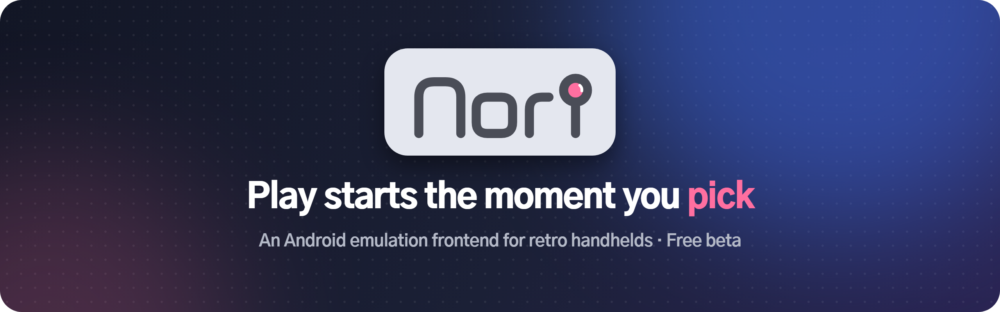
</p>

<p align="center">
  <a href="../../releases/latest"></a>
  <a href="../../releases"></a>
  
  
</p>

<p align="center">
  <a href="../../releases/latest"><b>⬇ Download</b></a> ·
  <a href="#getting-started">Getting started</a> ·
  <a href="#folder-layout">Folder layout</a> ·
  <a href="#systems-and-emulators">Systems</a> ·
  <a href="#faq">FAQ</a> ·
  <a href="../../issues/new/choose">Bug report</a> ·
  <a href="../../discussions">Questions & ideas</a>
</p>

<p align="center">
  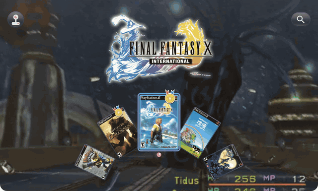
  <br><sub>Spin the wheel hard and it turns into a roulette that picks today's game. Real in-app footage.</sub>
</p>

> [!WARNING]
> Nori is a **frontend (launcher)**, not an emulator. **It does not include any games or emulators.**
> Install the emulators you want separately, and only use games you own.

> [!IMPORTANT]
> Nori is in **beta** and **free**. Expect some bugs.
> Please report anything odd in [Issues](../../issues/new/choose) and it will be fixed in the next version.

> [!NOTE]
> Nori is made by a solo developer in Korea. The app comes in English and Korean and follows your device language.
> English replies may be a little slow or go through a translator. Thanks for your patience!

## What is Nori?

- **A launcher.** Nori doesn't run games itself. It hands them to the emulators you already have (NetherSX2, PPSSPP, RetroArch and more).
- **Built for a gamepad, end to end.** Made for Android handhelds like the Retroid Pocket and AYN Odin, and still works with touch on phones and tablets.
- **Automatic artwork.** Point it at your ROM folder and it sorts games by system and matches box art, logos, backgrounds and preview videos.

## Tour

### Home — pick up where you left off
Your most recent game sits in the big tile, one press of A away. Play time for the last 30 days and this week's top game are right there too.

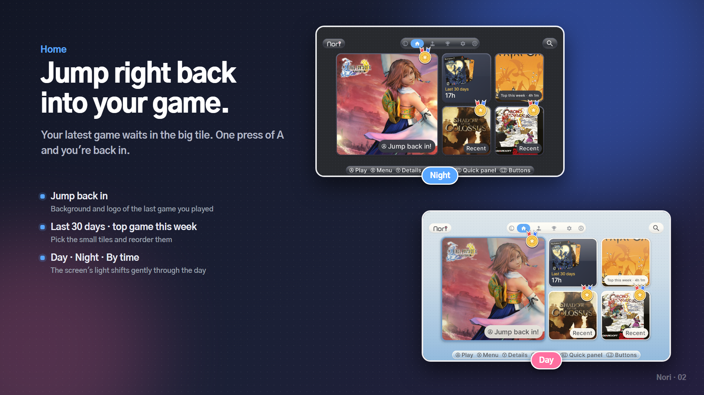

### Browsing — pick a system, pick a game
Choose a system in the system dock, then a game in the game dock. The game's background and logo fill the screen, and after a moment its preview video starts playing.

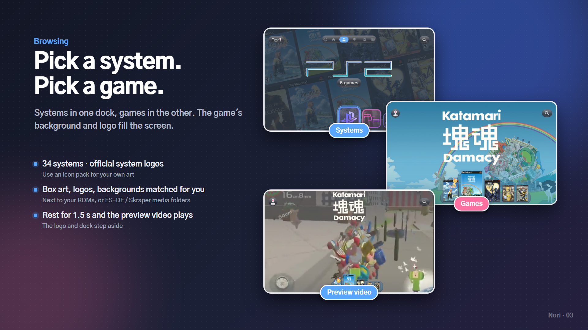

### Four styles
One tap in Settings changes the whole look, and each style has its own background music.

| Style | What it looks like |
| --- | --- |
| **Basic** | Clear glass docks, rounded tiles |
| **Pixel** | Square tiles, hard shadows, Galmuri pixel font |
| **Wheel** | Covers along a half-wheel at the bottom, spun with the stick |
| **List** | Titles on the left; cover, logo and description on the right |

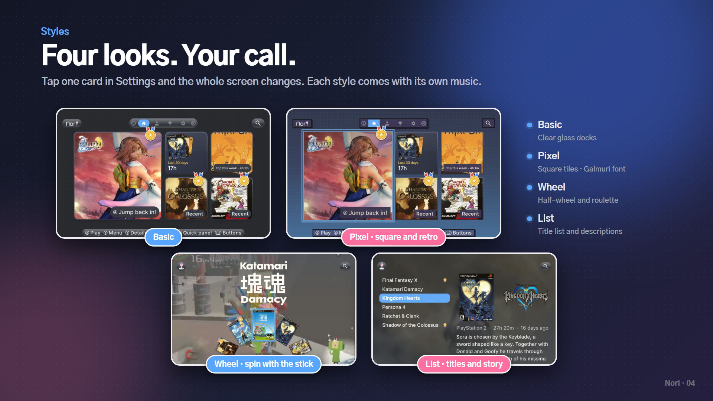

### Wheel — spin it hard for a roulette
Can't decide what to play? Give the wheel a hard spin. Wherever it stops, you get "🎲 This one today!".

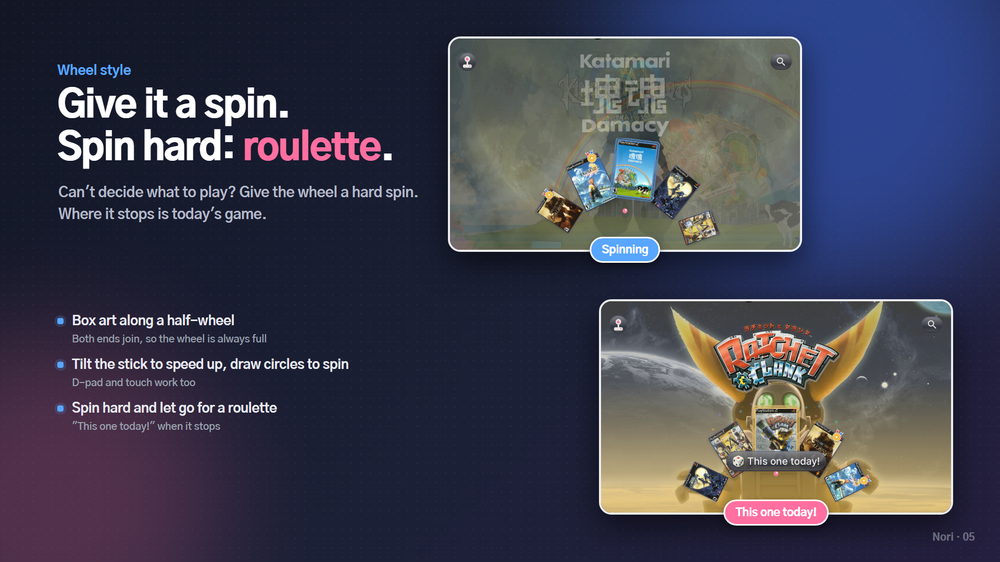

### List — titles on the left, the story on the right
Great for big libraries. Tall and wide box art both show large, and long descriptions scroll slowly on their own.

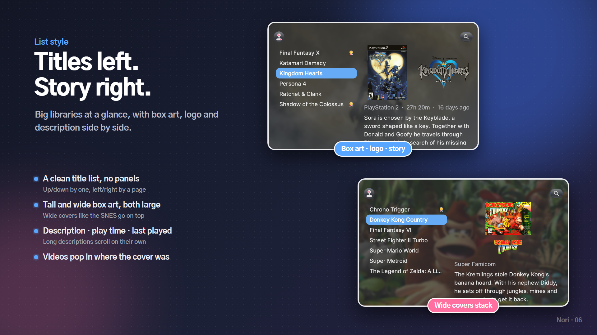

### Themes and colors
Day, Night, or By time. Night comes in navy or OLED black, and the accent palette comes in Basic blue or Neon (blue × red). Five bundled fonts plus your own TTF.

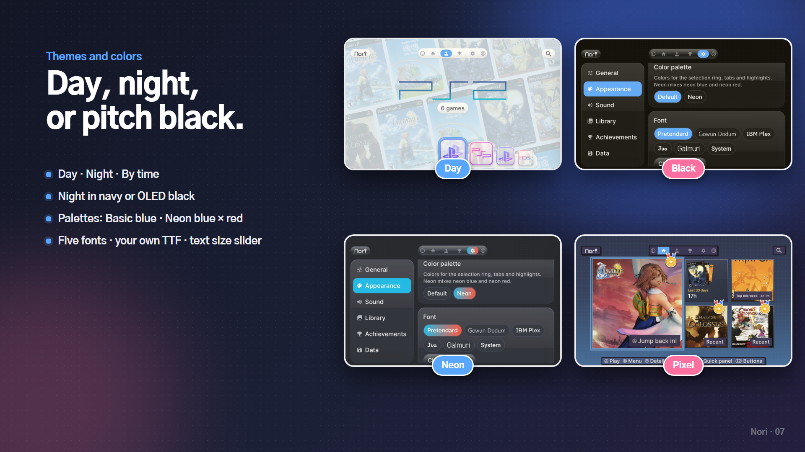

### Achievements and records
443 built-in achievements (bronze, silver, gold), per-game play time and rankings, and yearly and monthly records. Link your RetroAchievements account and beaten games get a medal.

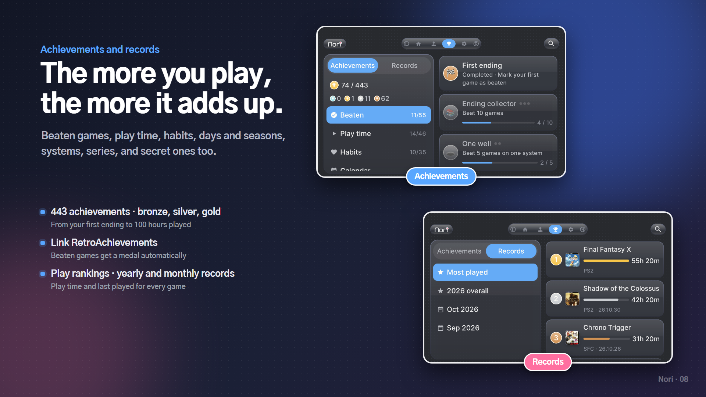

### Monthly recap
When a month ends, last month's story plays out one card at a time. A yearly recap shows up at the end of the year.

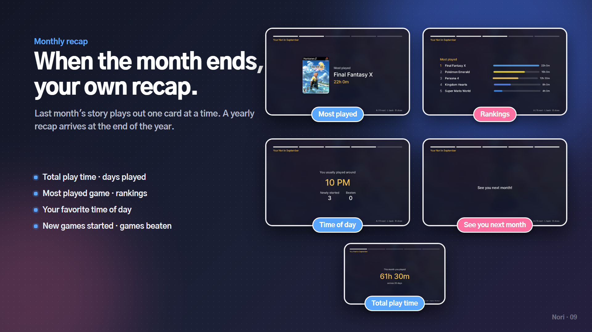

### Gamepad-first
Search by Korean initial consonants or the alphabet, an R2 quick panel (clock, battery, volume, today's play), an L2 button guide and an idle screen. Every button can be remapped in Settings.

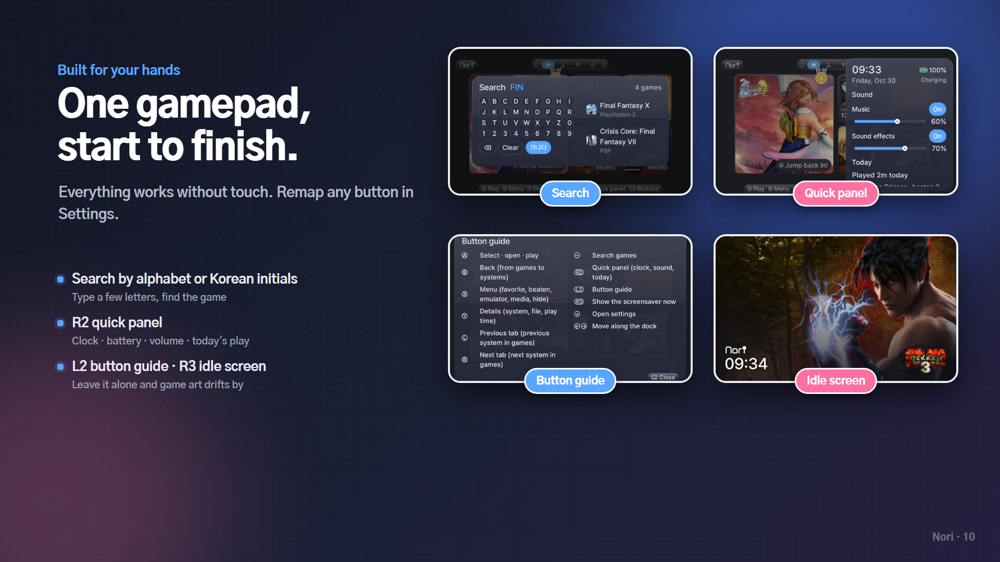

### Per-game options
X opens the menu and Y opens details: favorite, mark as beaten, use a different emulator for just this game, pick box art, logo, background or video yourself, or hide the game.

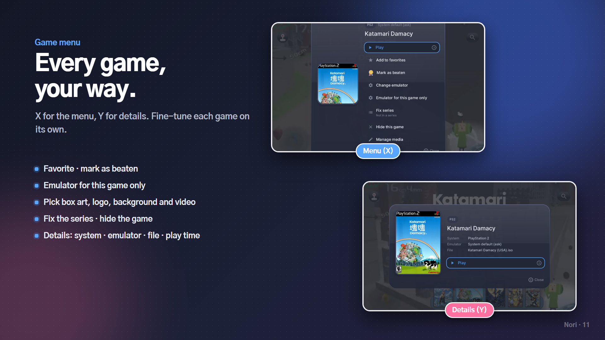

---

## Install and update

1. Download `Nori-<version>.apk` from [Releases](../../releases/latest).
2. Open the APK on your device. Allow installs from unknown sources if asked.

**When a new version comes out,** just install the new APK over the old one. Favorites, play history and settings are kept.
With [Obtainium](https://github.com/ImranR98/Obtainium) you get new versions automatically.

<p align="center">
  <a href="http://apps.obtainium.imranr.dev/redirect.html?r=obtainium://app/%7B%22id%22%3A%22app.nori%22%2C%22url%22%3A%22https%3A%2F%2Fgithub.com%2Fnori-launcher%2FNori%22%2C%22author%22%3A%22nori-launcher%22%2C%22name%22%3A%22Nori%22%7D">
    
  </a>
</p>

**Requirements:** Android 8.0 or later. Designed for landscape screens and tested mostly on 4:3 (1280×960).

The app follows your device language. To switch, go to Settings → General → Language.

## Getting started

### 1. First launch
A short setup runs the first time you open Nori.

1. **Start** — the welcome screen. Press any button to continue.
2. **ROM folder** — pick the folder with your games, split into system folders like `ps2`, `psp`, `snes`. (See [Folder layout](#folder-layout).)
3. **Metadata folder** — if you keep box art, logos and backgrounds in a separate folder, pick it here. Coming from ES-DE? Pick the **ES-DE folder** and Nori brings in your media plus the game names and descriptions. You can skip this step.

> [!TIP]
> You can change these folders anytime in Settings → Library → Artwork folders.

### 2. Worth doing next
- **Set up emulators** — in the system dock, select a system and press **X** to choose which emulator opens it. If a game won't start, check this first.
- **Fill missing art** — Settings → Library → **Fill missing art** finds box art, logos, backgrounds, videos and descriptions on ScreenScraper and the libretro repository, and saves them next to your ROMs.
- **Choose a style** — Settings → Appearance: Basic, Pixel, Wheel or List. Theme, colors, fonts and text size are here too.
- **Link RetroAchievements** — Settings → Achievements: enter your username and Web API key and beaten games get a medal. Find your key near the bottom of [retroachievements.org/settings](https://retroachievements.org/settings).
- **Remap buttons** — want a Nintendo-style layout (A and B swapped)? Change it in Settings → Controller.

> [!TIP]
> Switching devices? Settings → Data → **Export to file** moves your favorites, records and settings.

## Folder layout

Split your ROM folder into folders named after each system and Nori sorts everything out.

```
Roms/
├─ ps2/
│   ├─ Final Fantasy X.iso
│   ├─ Final Fantasy X.png        ← box art
│   ├─ Final Fantasy X-logo.png   ← logo
│   ├─ Final Fantasy X-bg.png     ← background
│   ├─ Final Fantasy X.mp4        ← preview video
│   └─ Final Fantasy X.txt        ← description (List style)
├─ psp/
├─ psx/
└─ snes/
```

- Put artwork next to the ROM with the same name, or in folders such as `covers`, `logos`, `fanart` and `videos`.
- Pick **ES-DE's `downloaded_media` or Skraper's `media` folder** as the metadata folder and Nori reads it as is.
- Pick the **ES-DE folder itself** and Nori also reads `gamelist.xml` from `gamelists`, so the names you set there (custom or translated titles) and the descriptions show up as they are. A `gamelist.xml` inside a system folder of your ROM folder works too.
- No artwork? No problem. Settings → Library → **Fill missing art** downloads it for you.
- Tags like `(USA)` or `[v1.1]` are hidden from titles. Multi-disc games (`.m3u`) and `.cue`+`.bin` show up as a single entry.

<details>
<summary><b>All system folder names</b></summary>

| System | Folder name (any one) |
| --- | --- |
| PlayStation 2 | `ps2` `playstation2` |
| PlayStation 3 | `ps3` `playstation3` |
| PSP | `psp` |
| PlayStation Vita | `psvita` `vita` `psv` |
| PlayStation | `psx` `ps1` `playstation` `ps` |
| GameCube | `gc` `gamecube` `ngc` |
| Wii | `wii` |
| Wii U | `wiiu` |
| Nintendo Switch | `switch` `nsw` `ns` |
| Nintendo 3DS | `3ds` `n3ds` `nintendo3ds` |
| Nintendo DS | `nds` `ds` |
| Nintendo 64 | `n64` |
| Game Boy Advance | `gba` |
| Game Boy Color | `gbc` |
| Game Boy | `gb` |
| Super Famicom / SNES | `snes` `sfc` `superfamicom` |
| Famicom / NES | `nes` `fc` `famicom` |
| Sega Saturn | `saturn` `ss` `segasaturn` |
| Dreamcast | `dreamcast` `dc` |
| Mega Drive / Genesis | `md` `genesis` `megadrive` |
| PC Engine | `pce` `pcengine` `tg16` |
| PC Engine CD | `pcecd` `pcenginecd` `tgcd` `turbografxcd` |
| Master System | `mastersystem` `sms` `segamastersystem` `mark3` |
| Game Gear | `gamegear` `gg` |
| Neo Geo Pocket | `ngp` `neogeopocket` |
| Neo Geo Pocket Color | `ngpc` `neogeopocketcolor` |
| WonderSwan | `wonderswan` `wswan` `ws` |
| WonderSwan Color | `wonderswancolor` `wswanc` `wsc` |
| MSX | `msx` `msx1` |
| MSX2 | `msx2` `msx2plus` `msxturbor` |
| X68000 | `x68000` `x68k` |
| PC-98 | `pc98` `pc9801` `pc-98` |
| MS-DOS | `dos` `msdos` `pc` |
| Arcade | `arcade` `fbneo` `mame` `neogeo` |

</details>

## Systems and emulators

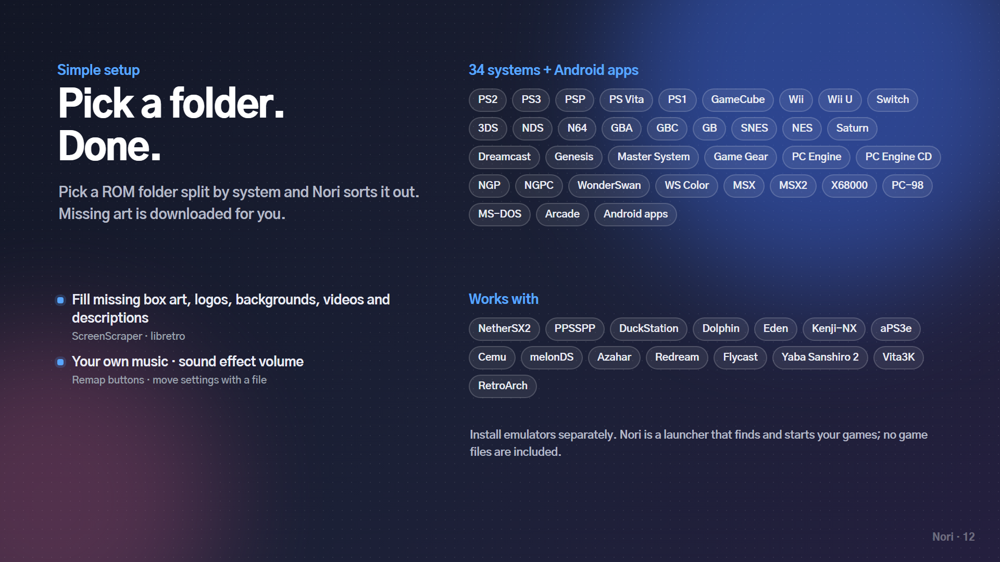

| System | Emulators that work out of the box |
| --- | --- |
| PS2 | NetherSX2 / AetherSX2 |
| PS3 | aPS3e, aPS3e Premium |
| PSP | PPSSPP, PPSSPP Gold |
| PS Vita | Vita3K |
| PS1 | DuckStation |
| GameCube · Wii | Dolphin |
| Wii U | Cemu |
| Switch | Eden, Kenji-NX, Skyline |
| 3DS | Azahar, Lime3DS |
| NDS | melonDS |
| Dreamcast | Redream, Flycast |
| Saturn | Yaba Sanshiro 2 |
| Other classic systems | RetroArch (download the cores inside RetroArch first) |

- For an emulator that isn't listed, choose "System default" and Android will ask which app to open each time.
- To open just one game with a different emulator: game menu (X) → "Emulator for this game only".
- Android apps (JoiPlay, regular games) can be added to the "Android" group and launched alongside everything else.

## Buttons

| Button | What it does |
| --- | --- |
| A | Select · open · start |
| B | Back (from a game list to the system list) |
| X | Menu (favorite · beaten · emulator · artwork · hide) |
| Y | Details (system · file · play time) |
| L / R | Switch between Home · Games · Achievements · Settings (switch systems inside a game list) |
| SELECT | Search (Korean initials · alphabet) |
| L2 | Button guide |
| R2 | Quick panel (clock · volume · today) |
| R3 | Idle screen |
| START | Settings |

## FAQ

<details>
<summary><b>Is Nori free?</b></summary>

Yes, during the beta. From version 1.0 it will become a one-time purchase that includes future updates.
</details>

<details>
<summary><b>A game won't start.</b></summary>

Check that the system has an emulator set: in the system dock, select the system and press **X**. For RetroArch, download the core you need inside RetroArch first.
</details>

<details>
<summary><b>Box art doesn't show up.</b></summary>

Make sure the artwork has the same name as the ROM (case and bracket tags are ignored). If there is no artwork at all, use Settings → Library → **Fill missing art**. It works best when ROM file names are close to the original English titles.
</details>

<details>
<summary><b>Can I reuse my ES-DE media and names?</b></summary>

Yes. Pick the **ES-DE folder itself** as the metadata folder and Nori reads the media in `downloaded_media` plus the names and descriptions in `gamelists`.
</details>

<details>
<summary><b>Does it work on phones?</b></summary>

Yes. It's designed for landscape and works with touch, but it's most comfortable on devices with built-in controls.
</details>

## Bugs and feedback

- Report bugs with the "Bug report" form in [Issues](../../issues/new/choose). Including your device, Nori version and emulator helps a lot.
- If Nori crashes, a "Send log" prompt appears the next time you open it. Please paste that log into the issue.
- Feature ideas are welcome in the "Feature request" form or in [Discussions](../../discussions/categories/ideas).
- Questions go to the [Q&A board](../../discussions/categories/q-a). Show off your Nori setup in [Show and tell](../../discussions/categories/show-and-tell)!
- Writing in English is totally fine. Replies may take a day or two since this is a one-person project, but everything gets read.

## Notes

- Nori does not provide any game files (ROMs or BIOS). Please only use games you own.
- System logos are used only to identify which system a game belongs to. They are trademarks of Sony, Nintendo, Sega, NEC and others, and Nori is not affiliated with these companies.
- Box art, logos and backgrounds belong to their respective owners.
- All bundled fonts are under the SIL Open Font License 1.1: [Pretendard](https://github.com/orioncactus/pretendard) · [Gowun Dodum](https://fonts.google.com/specimen/Gowun+Dodum) · [IBM Plex Sans KR](https://fonts.google.com/specimen/IBM+Plex+Sans+KR) · [Jua](https://fonts.google.com/specimen/Jua) · [Galmuri](https://github.com/quiple/galmuri).
- Artwork downloads use [ScreenScraper](https://www.screenscraper.fr) and [libretro-thumbnails](https://github.com/libretro-thumbnails/libretro-thumbnails).

---

<p align="center">Made by 장재복</p>
