<p align="center">
  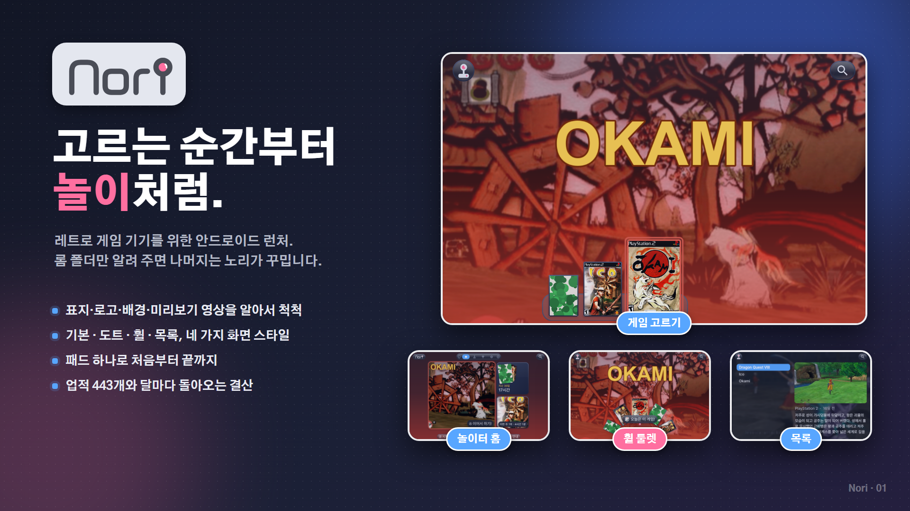
</p>

<h1 align="center">Nori</h1>

<p align="center">
  레트로 게임 기기를 위한 안드로이드 런처(프런트엔드)<br>
  롬 폴더만 알려 주면 표지·로고·배경·미리보기 영상까지 알아서 꾸며 줍니다.
</p>

<p align="center">
  <a href="../../releases/latest"><b>⬇ 최신판 받기</b></a> ·
  <a href="#설치">설치</a> ·
  <a href="#폴더-준비">폴더 준비</a> ·
  <a href="#지원-기기와-에뮬레이터">지원 기기</a> ·
  <a href="../../issues/new/choose">버그 제보 · 건의</a>
</p>

---

## 노리는 이런 앱입니다

- **런처입니다.** 게임을 직접 돌리지 않습니다. 이미 깔린 에뮬레이터(NetherSX2, PPSSPP, RetroArch 등)에 게임을 넘겨 띄워 줍니다.
- **패드 하나로 끝까지** 쓸 수 있게 만들었습니다. 레트로이드 포켓, AYN 오딘처럼 패드가 달린 안드로이드 기기에 맞췄고, 휴대폰·태블릿에서도 손가락으로 씁니다.
- **한국어가 기본**입니다. 초성으로 게임을 찾고, 한글 패치 롬도 그대로 씁니다.
- 게임 파일과 에뮬레이터는 들어 있지 않습니다.

## 둘러보기

### 놀이터 홈 — 켜자마자, 하던 게임으로
가장 최근에 한 게임이 큰 칸에 걸려 있어 A 한 번이면 이어서 합니다. 지난 30일 플레이 시간과 이번 주 1위 게임도 한눈에 보입니다.

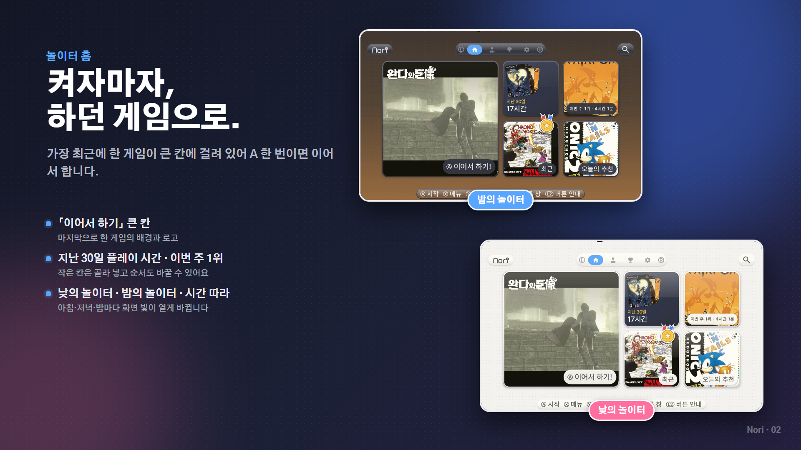

### 게임 고르기 — 기기를 고르고, 게임을 고르고
기기 독에서 기기를, 게임 독에서 게임을 고릅니다. 고른 게임의 배경과 로고가 화면을 가득 채우고, 잠시 머물면 미리보기 영상이 흐릅니다.

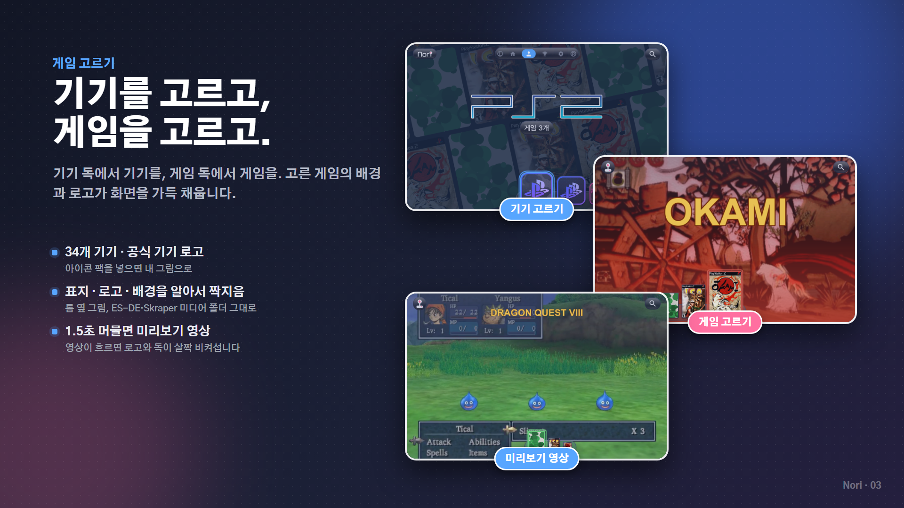

### 화면 스타일 네 가지
설정에서 카드 하나만 누르면 화면 전체가 바뀝니다. 스타일마다 어울리는 배경음악도 따로 붙어 있습니다.

| 스타일 | 특징 |
| --- | --- |
| **기본** | 유리처럼 맑은 독, 둥근 칸 |
| **도트** | 각진 칸과 딱딱한 그림자, 갈무리 글꼴 |
| **휠** | 화면 아래 반원 휠에 표지가 늘어서고, 스틱으로 돌려 고름 |
| **목록** | 왼쪽에 제목 목록, 오른쪽에 표지·로고·게임 설명 |

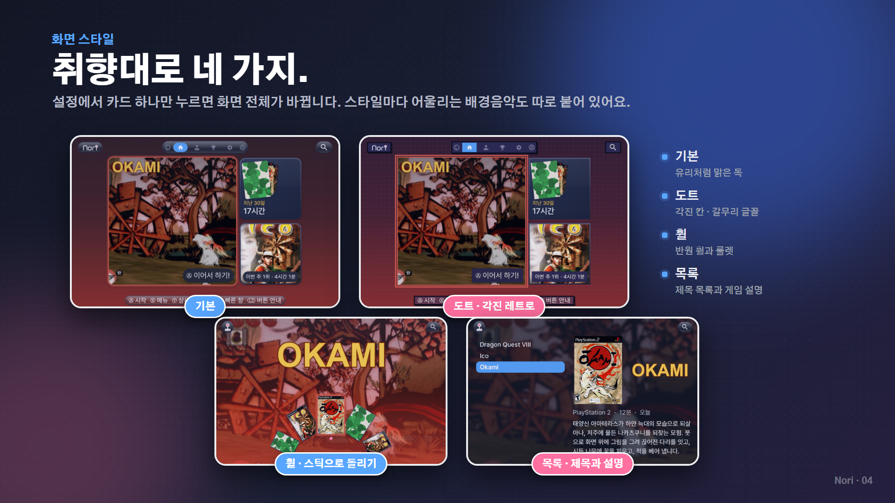

### 휠 — 세게 돌리면 룰렛
뭘 할지 모르겠는 날엔 휠을 힘껏 돌려 보세요. 멈춘 자리에 「오늘은 이 게임!」이 뜹니다.

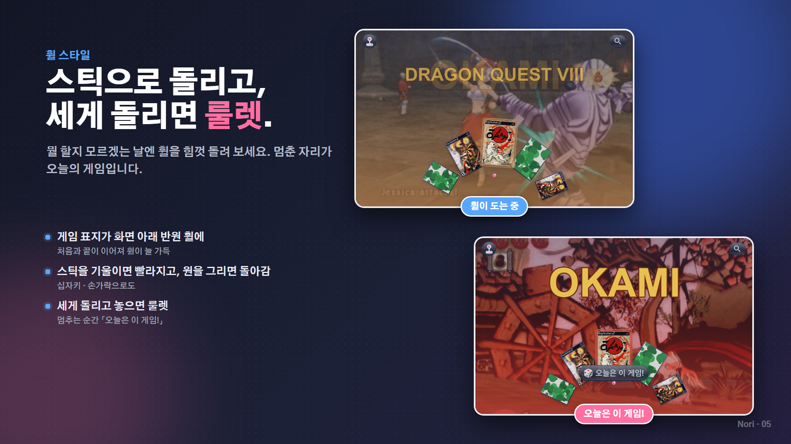

### 목록 — 제목은 왼쪽, 이야기는 오른쪽
게임이 많아도 한눈에 보입니다. 세로형·가로형 표지 모두 크게 보이고, 게임 설명은 길면 저절로 천천히 내려갑니다.

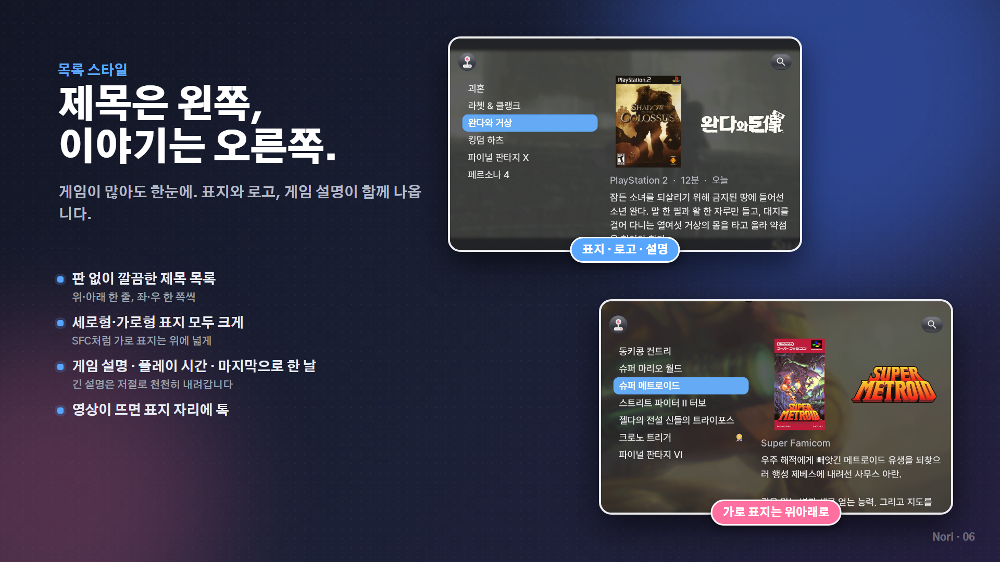

### 테마와 색
낮의 놀이터 · 밤의 놀이터 · 시간 따라. 밤 색은 남색과 OLED 블랙 중에 고르고, 색상 팔레트는 기본 파랑과 네온(파랑×빨강)이 있습니다. 글꼴 다섯 가지에 내 TTF 글꼴도 쓸 수 있습니다.

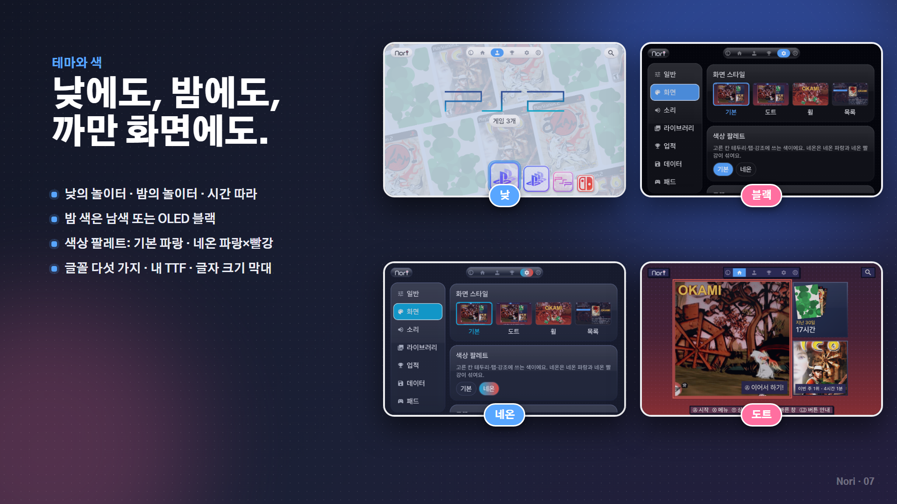

### 업적과 기록
업적 443개(동·은·금), 게임별 플레이 시간과 순위, 해마다·달마다 기록이 쌓입니다. RetroAchievements 계정을 연결하면 클리어한 게임에 메달이 붙습니다.

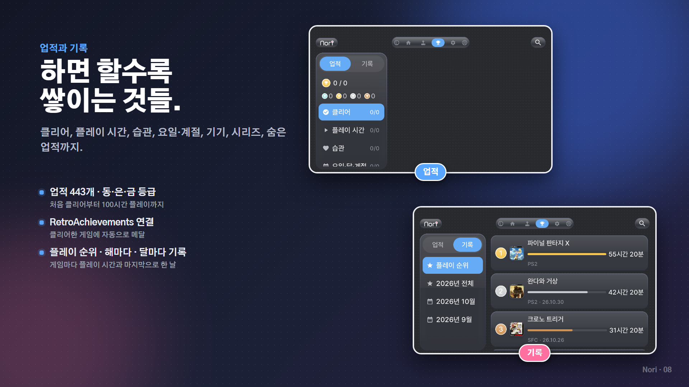

### 이달의 노리 — 한 달이 끝나면, 나만의 결산
달이 바뀌면 지난달 이야기가 한 장씩 넘어갑니다. 연말에는 한 해 결산도 나옵니다.

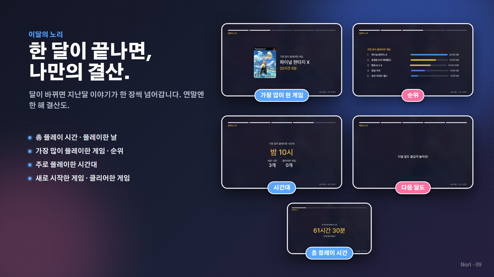

### 패드 하나로 끝까지
초성 찾기(ㅍㅍ → 파이널 판타지), R2 빠른 창(시계·배터리·소리·오늘 플레이), L2 버튼 안내, 대기 화면. 단추가 하는 일은 설정에서 바꿀 수 있습니다.

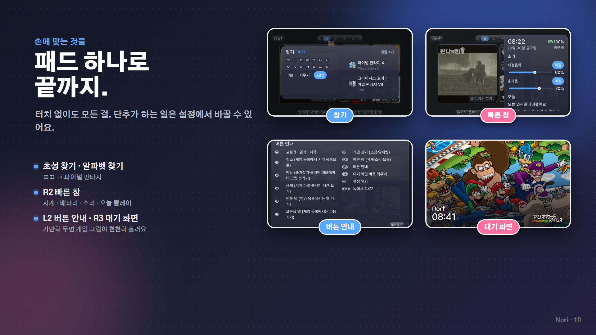

### 게임마다 내 마음대로
X는 메뉴, Y는 상세입니다. 즐겨찾기, 클리어 표시, 이 게임만 에뮬레이터 바꾸기, 표지·로고·배경·영상 직접 고르기, 숨기기를 할 수 있습니다.

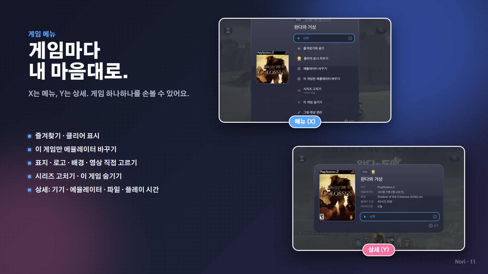

---

## 설치

1. [Releases](../../releases/latest)에서 `Nori-버전.apk`를 받습니다.
2. 기기에서 APK를 엽니다. 「출처를 알 수 없는 앱」 설치를 묻으면 허용합니다.
3. 노리를 열고 **롬 폴더**를 고릅니다. 메타데이터(그림) 폴더가 따로 있으면 다음 단계에서 고릅니다.
4. 쓰려는 에뮬레이터를 따로 설치합니다. 기기 독에서 기기를 고른 채 **X**를 누르면 그 기기를 어느 에뮬레이터로 열지 고를 수 있습니다.

> **업데이트:** 새 APK를 덮어 깔면 됩니다. 즐겨찾기·플레이 기록·설정은 그대로 남습니다.
> 기기를 바꿀 때는 설정 → 데이터 → 「파일로 내보내기」로 옮기세요.

**필요 사양:** 안드로이드 8.0 이상. 가로 화면에 맞춰 만들었고, 주로 4:3 화면(1280×960)에서 확인했습니다.

## 폴더 준비

롬 폴더 아래에 기기 이름으로 폴더를 나눠 두면 알아서 가릅니다.

```
Roms/
├─ ps2/
│   ├─ Dragon Quest VIII.iso
│   ├─ Dragon Quest VIII.png        ← 표지
│   ├─ Dragon Quest VIII-logo.png   ← 로고
│   ├─ Dragon Quest VIII-bg.png     ← 배경
│   ├─ Dragon Quest VIII.mp4        ← 미리보기 영상
│   └─ Dragon Quest VIII.txt        ← 게임 설명 (목록 스타일)
├─ psp/
├─ psx/
└─ snes/
```

- 그림은 롬과 같은 이름으로 롬 옆에 두거나, `covers` · `logos` · `fanart` · `videos` 같은 폴더에 넣어도 됩니다.
- **ES-DE의 `downloaded_media`나 Skraper의 `media` 폴더**를 메타데이터 폴더로 고르면 그대로 읽습니다.
- **ES-DE 폴더 자체**를 메타데이터 폴더로 고르면 `gamelists`의 `gamelist.xml`도 읽어서, 거기 적은 게임 이름(예: 「(한) 드래곤 퀘스트 VIII」)과 게임 설명이 그대로 뜹니다. 롬 폴더의 기기 폴더에 둔 `gamelist.xml`도 읽습니다.
- 그림이 없어도 괜찮습니다. 설정 → 라이브러리 → **「빈 그림 받기」**를 누르면 ScreenScraper와 libretro 저장소에서 표지·로고·배경·영상·설명을 찾아 롬 옆에 저장합니다.
- 제목의 `(Korea)` `[v1.1]` 같은 꼬리표는 떼고 보여 줍니다. 여러 장 디스크(`.m3u`)와 `.cue`+`.bin`은 하나로 묶어 보입니다.

<details>
<summary><b>기기 폴더 이름 전체 보기</b></summary>

| 기기 | 폴더 이름 (아무거나 하나) |
| --- | --- |
| PlayStation 2 | `ps2` `playstation2` |
| PlayStation 3 | `ps3` `playstation3` |
| PSP | `psp` |
| PlayStation Vita | `psvita` `vita` `psv` |
| PlayStation | `psx` `ps1` `playstation` `ps` |
| GameCube | `gc` `gamecube` `ngc` |
| Wii | `wii` |
| Wii U | `wiiu` |
| Nintendo Switch | `switch` `nsw` `ns` |
| Nintendo 3DS | `3ds` `n3ds` `nintendo3ds` |
| Nintendo DS | `nds` `ds` |
| Nintendo 64 | `n64` |
| Game Boy Advance | `gba` |
| Game Boy Color | `gbc` |
| Game Boy | `gb` |
| Super Famicom | `snes` `sfc` `superfamicom` |
| Famicom | `nes` `fc` `famicom` |
| Sega Saturn | `saturn` `ss` `segasaturn` |
| Dreamcast | `dreamcast` `dc` |
| Mega Drive | `md` `genesis` `megadrive` |
| PC Engine | `pce` `pcengine` `tg16` |
| PC Engine CD | `pcecd` `pcenginecd` `tgcd` `turbografxcd` |
| Master System | `mastersystem` `sms` `segamastersystem` `mark3` |
| Game Gear | `gamegear` `gg` |
| Neo Geo Pocket | `ngp` `neogeopocket` |
| Neo Geo Pocket Color | `ngpc` `neogeopocketcolor` |
| WonderSwan | `wonderswan` `wswan` `ws` |
| WonderSwan Color | `wonderswancolor` `wswanc` `wsc` |
| MSX | `msx` `msx1` |
| MSX2 | `msx2` `msx2plus` `msxturbor` |
| X68000 | `x68000` `x68k` |
| PC-98 | `pc98` `pc9801` `pc-98` |
| MS-DOS | `dos` `msdos` `pc` |
| Arcade | `arcade` `fbneo` `mame` `neogeo` |

</details>

## 지원 기기와 에뮬레이터

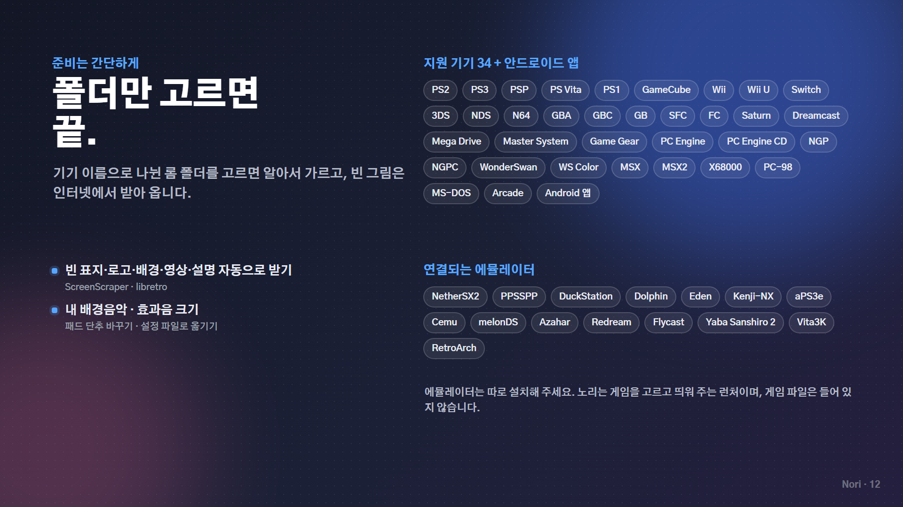

| 기기 | 바로 연결되는 에뮬레이터 |
| --- | --- |
| PS2 | NetherSX2 / AetherSX2 |
| PS3 | aPS3e, aPS3e Premium |
| PSP | PPSSPP, PPSSPP Gold |
| PS Vita | Vita3K |
| PS1 | DuckStation |
| GameCube · Wii | Dolphin |
| Wii U | Cemu |
| Switch | Eden, Kenji-NX, Skyline |
| 3DS | Azahar, Lime3DS |
| NDS | melonDS |
| Dreamcast | Redream, Flycast |
| Saturn | Yaba Sanshiro 2 |
| 그 밖의 고전기 | RetroArch (코어는 RetroArch 안에서 먼저 받아 두세요) |

- 목록에 없는 에뮬레이터는 「시스템 기본」을 고르면 실행할 때마다 열 앱을 고를 수 있습니다.
- 게임 하나만 다른 에뮬레이터로 열고 싶으면 게임 메뉴(X) → 「이 게임만 에뮬레이터 바꾸기」.
- 안드로이드 앱(조이플레이, 일반 게임 앱)도 「Android」 묶음에 넣어 같이 띄울 수 있습니다.

## 버튼

| 단추 | 하는 일 |
| --- | --- |
| A | 고르기 · 열기 · 시작 |
| B | 취소 (게임 목록에서 기기 목록으로) |
| X | 메뉴 (즐겨찾기 · 클리어 · 에뮬레이터 · 그림 · 숨기기) |
| Y | 상세 (기기 · 파일 · 플레이 시간) |
| L / R | 놀이터 · 게임 · 업적 · 설정 넘기기 (게임 목록에서는 기기 넘기기) |
| SELECT | 게임 찾기 (초성 · 알파벳) |
| L2 | 버튼 안내 |
| R2 | 빠른 창 (시계 · 소리 · 오늘) |
| R3 | 대기 화면 바로 띄우기 |
| START | 설정 |

## 제보 · 건의

- 버그는 [이슈](../../issues/new/choose)의 「버그 제보」 양식으로 남겨 주세요. 기기 이름, 노리 버전, 에뮬레이터를 적어 주시면 빨리 고칠 수 있습니다.
- 노리가 갑자기 꺼지면 다음에 켤 때 「오류 기록 보내기」가 뜹니다. 그 내용을 이슈에 붙여 주세요.
- 하고 싶은 기능은 「기능 건의」 양식으로 받습니다.

## 알아 두실 점

- 노리는 게임 파일(롬·바이오스)을 제공하지 않습니다. 본인이 가진 게임으로만 써 주세요.
- 기기 로고는 어느 기기의 게임인지 알아보기 위한 표시로만 씁니다. 소니, 닌텐도, 세가, NEC 등 각 회사의 상표이며, 노리는 이 회사들과 관계가 없습니다.
- 게임 표지·로고·배경 그림의 권리는 각 회사에 있습니다.
- 같이 넣은 글꼴은 모두 SIL Open Font License 1.1을 따릅니다: [Pretendard](https://github.com/orioncactus/pretendard) · [고운돋움](https://fonts.google.com/specimen/Gowun+Dodum) · [IBM Plex Sans KR](https://fonts.google.com/specimen/IBM+Plex+Sans+KR) · [Jua](https://fonts.google.com/specimen/Jua) · [갈무리](https://github.com/quiple/galmuri).
- 그림 자동 받기는 [ScreenScraper](https://www.screenscraper.fr)와 [libretro-thumbnails](https://github.com/libretro-thumbnails/libretro-thumbnails)를 씁니다.

---

<p align="center">제작: 장재복</p>
